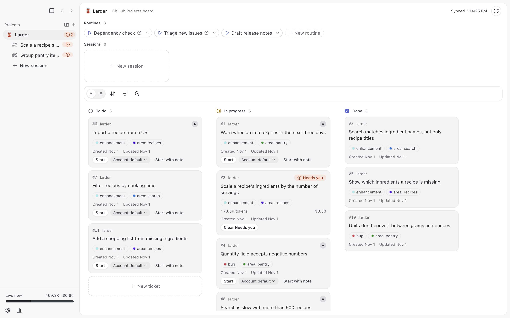
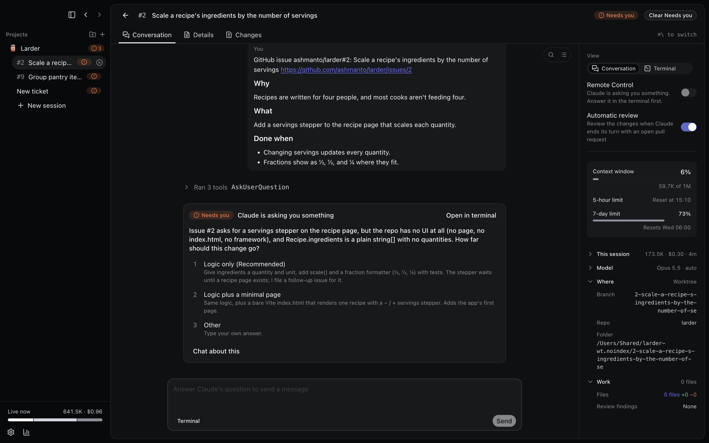
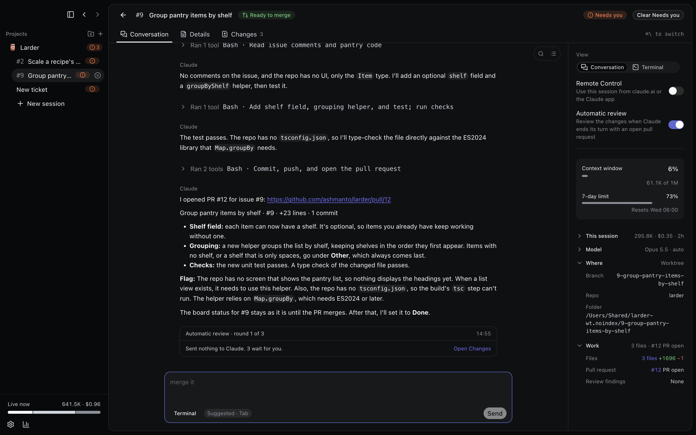
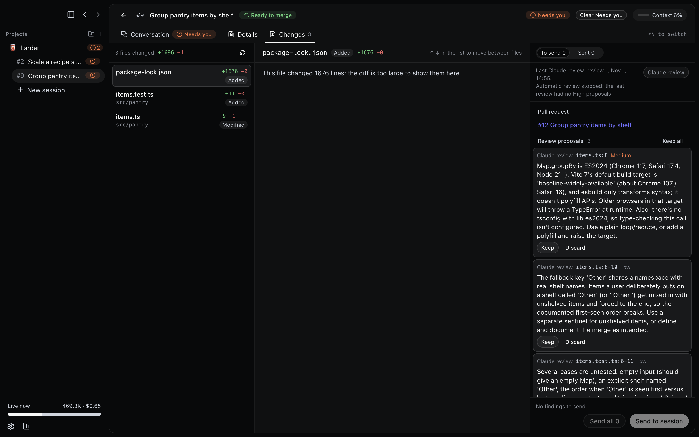
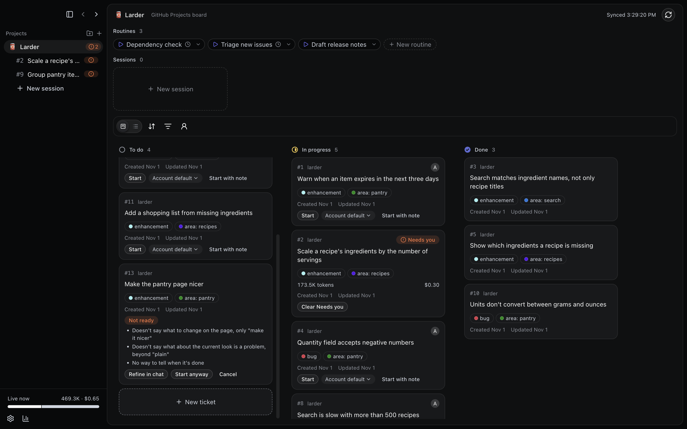

<h1>
  <picture>
    <source media="(prefers-color-scheme: dark)" srcset="docs/logo-dark.png">
    
  </picture>
</h1>

Sandtable is a macOS app that shows a project's tickets on a kanban board and runs one
interactive Claude Code session per ticket, each in its own git worktree and tmux session.
Tickets come from a GitHub Projects board, a set of repos' issues, a Linear team, or a Jira Cloud
project.

<picture>
  <source media="(prefers-color-scheme: dark)" srcset="docs/screenshots/board-dark.png">
  
</picture>

**Caution:** Each session is a Claude Code agent with write access to its worktree, and it can
push branches and open pull requests with your `gh` login. Review what it does, as you would for
any Claude Code session.

## Features

The following list is an overview. For the full list, see [What works today](docs/features.md).

- A board with **To do**, **In progress**, and **Done** columns, or a list, grouped by assignee or
  parent, filtered by label, repo, or assignee, and searched by title or ticket number. Drag a card to change its status or assignee.
- **Start** on a card checks for open blockers, whether the ticket is ready, and whether it
  overlaps tickets in the same area that are in progress or have a live session, then starts
  Claude Code in a fresh worktree.
- Sessions live in tmux, so they keep running after you close Sandtable, and Sandtable reconnects
  to them when it opens again.
- Session states, **Running**, **Needs you**, **Idle**, **Done** (routine sessions only), and
  **Finished**, come from Claude Code hooks, with a macOS notification and a Dock count when a
  session needs you. **Reviewing** comes from automatic review while one of its rounds runs.
  **Limit reached**, with its reset time, and **API error** show when a turn fails on a plan limit
  or an API error.
- A `sandtable` command in each ticket session, so Claude can start, check, and wait for other
  tickets' sessions in the same project and take their work with git. New sessions go through the
  same **Start** checks.
- A ticket view with the ticket's details, the live conversation with a composer, a terminal, and
  the session's changes.
- A review loop: an AI review of the diff against its ticket's **Done when**, failing checks, and
  open review threads, collected as findings you send to the session. With **Automatic review** on
  for a project or a session, the review runs when Claude ends its turn with an open pull request,
  sends the **High** line proposals to the session, and leaves the rest for you, for up to 3
  rounds. It also holds back the pull request until the rounds end and you've decided every
  proposal, and runs a round when Claude tries to open it. The session shows **Reviewing**
  while a round runs, and the conversation records each round and how it went.
- Answer Claude's questions and permission prompts on a card in the conversation.
- A ticket chat that drafts comments, triage that suggests areas and blockers, and a summary draft
  when a session finishes. Sandtable posts or applies nothing until you click.
- Sessions without a ticket, and routines: saved session starts you can run by hand, on a
  schedule, or when a ticket gets a label or its pull request checks fail.
- Per-project settings for the Claude Code account, model, token cap, automatic review, sandboxed
  commands, worktree setup, and instructions for ticket sessions.
- A **Usage** page with token use, estimated API cost, and ticket throughput by week, and live
  token use for running sessions.
- Remote Control, so you can use a session from claude.ai or the Claude app.
- Light and dark modes.

## Screenshots

The following screenshots show a demo project. More, including project setup, routines, and
ticket drafting, are in [the screenshots folder](docs/screenshots).

<table>
  <tr>
    <td>
      
      Answer Claude's questions on a card.
    </td>
    <td>
      
      Automatic review runs when Claude opens a pull request.
    </td>
  </tr>
  <tr>
    <td>
      
      Review a session's changes and send findings to it.
    </td>
    <td>
      
      Start checks that a ticket is ready first.
    </td>
  </tr>
</table>

## Requirements

- macOS 13 or later on Apple silicon, and the Node version in `.nvmrc` to build it.
- `tmux`, `claude` (Claude Code, logged in), `git`, and `gh` logged in with the `repo` scope,
  plus the `project` scope for GitHub Projects boards: `gh auth login --scopes project`.
- For a Linear project: the `linear` CLI (`brew install schpet/tap/linear`), signed in with
  `linear auth login` to each workspace you use.
- For a Jira project: an Atlassian API token for your account on its `<name>.atlassian.net` site,
  which you enter in **Add project**, and, for sessions to file and update issues, the `acli` Jira
  CLI (`brew tap atlassian/homebrew-acli && brew install acli`), signed in with
  `acli jira auth login --web`.
- For Remote Control: `claude` signed in with a claude.ai subscription, not an API key.
- For a Claude Code account other than **Default**, or when `CLAUDE_CONFIG_DIR` is set: tmux 3.2
  or later.

Sandtable reads your login shell's `PATH` to find these tools. On first run, a setup guide checks
them and shows the command that fixes each failed check.

## Install

To install Sandtable with Homebrew, run the following commands:

```bash
brew tap ashmanto/tap
brew trust ashmanto/tap
brew install --cask sandtable
```

Homebrew installs casks only from taps you trust. The cask also installs `gh` and `tmux`.

You can also download the DMG from the
[latest release](https://github.com/ashmanto/sandtable/releases/latest), open it, and drag
**Sandtable** to **Applications**.

The app is signed ad hoc and isn't notarized, so if macOS refuses to open it, click **Open
Anyway** in **System Settings > Privacy & Security**. The app runs under the hardened runtime, so macOS
ignores `DYLD_INSERT_LIBRARIES`, and it quits when started with any command-line switch besides
`--user-data-dir`.

## Build from source

```bash
npm install
npm run build:mac
cp -R dist/mac-arm64/Sandtable.app /Applications/
```

To update a copy you built, run `make install` on `master`. It pulls, runs the checks, builds,
runs the end-to-end tests, and replaces the app. Your sessions keep running in tmux.

To build a DMG, run `make dmg`. It builds `dist/Sandtable-<version>-arm64.dmg`. Releases are
built in CI instead; see [Release a version](CONTRIBUTING.md#release-a-version).

## Add a project

Click **Add project**, the plus beside the sidebar's **Projects** heading, then follow the four steps:

1. **Name:** enter the name shown in the sidebar and the board header.
2. **Tickets from:** choose **GitHub Projects board**, **Repo issues**, **Linear team**, or **Jira
   project**. For a
   board, paste its URL, such as `https://github.com/users/<you>/projects/2`, click **Load
   board**, and pick which Status option means to do, in progress, and done. For a Linear team,
   choose the workspace (it starts at the CLI's default one), the team, and, optionally, the
   Linear projects whose issues you want. For a Jira project, choose a saved Jira account, or
   click **Add a Jira account…** and enter the site, such as `yourteam.atlassian.net`, your
   Atlassian email, and an API token; then choose the project from the list, which you can
   filter, and its board. With one board it's chosen for you; **No board (show every issue)**
   shows the backlog too.
3. **Repos:** with a board, include the board's repos you work on; with repo issues, a Linear
   team, or a Jira project, enter each repo as `owner/name`. Then click **Choose folder…** for each repo and select its local folder.
   Sandtable refuses a folder whose git remote doesn't point at that repo. You can also click
   **Add from a folder…** to fill in the repo from a folder's remote. The folder dialog opens in
   the folder that holds the last folder you picked, or in your home folder the first time.
4. **Review:** check the project, optionally pick an emoji as its icon from a searchable grid,
   choose whether its sessions start with Remote Control, which
   Claude Code account they use, which model they run on (**Model**: **Account default**, the
   default, or **Fable**, **Opus**, **Sonnet**, or **Haiku**), which editor a session's folders
   open in (**Editor**: an app you choose), how long done tickets stay on the board (**Keep done
   tickets**: 1, 3, 7, 14, or 30 days, 7 by default), how many tokens a session may use before
   Sandtable stops its tool calls (**Token cap**: 10M, 25M, 50M, 100M, or 250M, off by default), whether **Start** first checks that a
   ticket is ready (**Readiness check**, on by default), whether Claude reviews a ticket
   session's changes when it ends its turn with an open pull request (**Automatic review**, off by
   default), whether its sessions run Bash in Claude
   Code's sandbox (**Sandbox commands**, off by default, with optional **Allowed domains**), optionally write **Instructions** that
   ticket sessions get after Sandtable's rules, for every ticket and for tickets with a given
   label, and click **Save**. Add an account on the **Settings** screen
   first to choose it here.

To change a project, click **Edit project** in its **More** menu in the sidebar. The same steps open, filled in, on the
**Review** step, where **Delete project** is.

## Development

To contribute, see [Contributing to Sandtable](CONTRIBUTING.md). For commands and conventions,
see `CLAUDE.md`. For the look, see `DESIGN.md`. The capability record is `docs/features.md`.

## License

Sandtable is released under the
[Functional Source License, Version 1.1, MIT Future License](LICENSE.md) (FSL-1.1-MIT). You can
use, change, and share it for any purpose except offering a commercial product or service that
competes with Sandtable. Each version becomes available under the MIT License two years after its
release.
